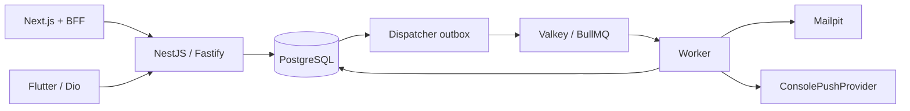

# Arquitectura

Estado: implementada como monolito modular; PostgreSQL, Valkey, Mailpit y fixture MinIO opcional de Compose validados. Adapter S3 opcional probado contra MinIO local; filesystem sigue predeterminado.

## Límites de módulos

Auth controla identidad y sesiones. Organizations controla organizaciones, Memberships e invitaciones. Policy resuelve autorización contra Membership activa. Services controla posiciones, lifecycle, intereses, asignaciones y confirmaciones. Catalog agrupa roles, grupos, avisos, settings y consulta de notificaciones; podría separarse cuando lo justifique el tamaño.

Chats controla conversaciones manuales/de servicio, participantes, historial, lectura y visibilidad individual. Comprueba Membership y features.chat antes de operar; los participantes del chat de servicio derivan de asignaciones confirmadas. Sigue siendo un módulo del mismo monolito.

Los controladores validan entrada; los servicios aplican reglas y transacciones. PostgreSQL protege invariantes con claves compuestas, índices, checks y trigger de capacidad. No mover autorización a la UI ni usar organizationId del cliente como prueba de acceso.

Packages/contracts contiene contratos Zod y tipos públicos; shared contiene reglas puras; config valida variables. Prisma permanece interno al servidor, no se comparte su cliente con web o móvil.

## Eventos y proveedores

Una mutación guarda AuditEvent y DomainEvent en la misma transacción cuando corresponde. El worker despacha outbox a BullMQ y materializa Notification por destinatario. PushNotificationProvider y MailProvider separan transporte del dominio. `ObjectStorageProvider` expone `getObject`, `putObject` y `deleteObject` con claves y tipo de contenido; `LocalObjectStorage` es el proveedor gratuito por defecto para la foto de perfil. `S3ObjectStorage` es opcional y se probó contra MinIO local con `@aws-sdk/client-s3`; no requiere cuenta AWS. Las rutas de Auth y Organizations comprueban identidad/Membership antes de usar cualquiera de los proveedores. No hay uploads generales de documentos todavía.

La API y el worker son procesos independientes del mismo repositorio, no microservicios. Compartir PostgreSQL simplifica integridad y operación. Escalar procesos sólo cuando haya mediciones; no introducir Kubernetes, bus distribuido ni infraestructura contratada.

Ver DECISIONS.md, NOTIFICATIONS.md y MULTI_TENANCY.md para consecuencias y límites.

Perfil propio pertenece al módulo Auth por su alcance global de identidad. ProfileService encapsula consultas/edición de nombres y procesamiento/storage de avatar, sin dependencia HTTP ni de organizaciones. AuthController mantiene validación del contrato, identidad autenticada y cabeceras de transporte; ProfileService permanece privado al módulo. La foto de otro participante se autoriza desde OrganizationsService por Membership; no se expone el storage directamente a clientes.
